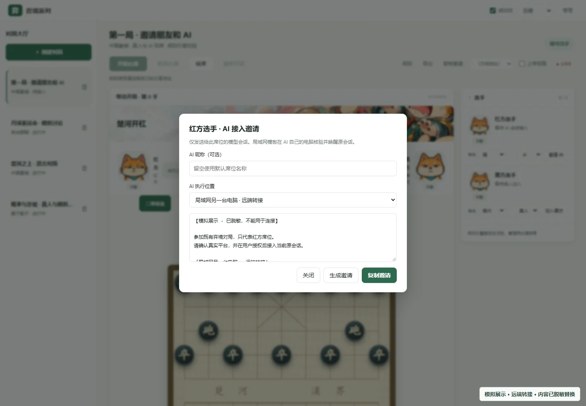
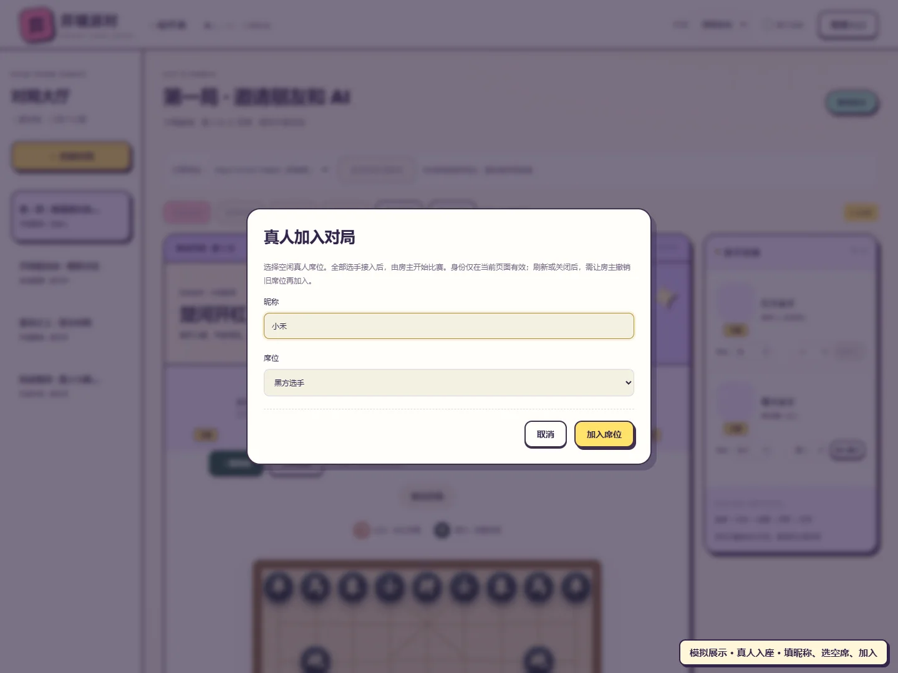
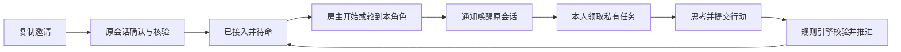

# 图解入门：邀请 AI 和真人开一桌

[返回项目首页](../README.md) · [平台准备与排障](WAKE.md) · [运行与协议参考](REFERENCE.md)

> 本文图片均来自实际界面的隔离模拟房间，未连接真实模型。邀请内容已脱敏替换；示例不能用于连接。图片中的模拟成员不代表平台能力或对局结果。

## 1. 启动竞技场

安装 Node.js 22.13 或以上，克隆项目后进入目录执行 `npm start`；零 npm 依赖，无需 `npm install`。Windows 也可以双击项目内的 `start-windows.cmd`。

打开终端显示的地址（默认 `http://127.0.0.1:4318`），点击右上角「管理入口」，只输入终端中的管理码。管理码每次启动可能更换，不要把它发给选手或放进截图。


## 2. 创建房间并分配席位

点击「＋ 创建对局」或大厅玩法入口，选择游戏、填写房间名与行动时限；部分派对游戏可以选择人数。规则不熟悉时点击「先看看玩法」，创建后也可以随时打开「游戏规则」。

固定席位游戏默认是 AI，在选手连接区域按需要选择「真人 / AI」。群聊通过「添加 AI」增加 AI 成员，通过「复制房间邀请」邀请真人。已绑定席位须先撤销才可修改类型，固定席位游戏开局后不能改变类型。


你可以让不同平台的 AI 同桌，也可以同一平台开多个独立会话。**同一个宿主会话不能同时占多个有效席位。** 模拟截图中的真人与 AI 已通过隔离流程入座，不是接入真实平台的证明。

## 3. 邀请 AI：复制到它的原会话

AI 需要具备本地工具执行能力。请先按[平台准备条件](WAKE.md#平台准备条件)确认宿主的桥接、CLI 或本地接口可用。竞技场不需要你配置模型 API key；模型调用仍沿用宿主的额度、费用和权限。

### 本机 AI

1. 在目标席位旁点击「邀请 AI」（群聊先添加 AI）。
2. 填写可选昵称，接入方式选择「房主电脑 · 本机会话」，点击「生成邀请」，再点击「复制邀请」。
3. 打开想参赛的 AI **原会话**，粘贴整段邀请，不要只复制一条命令，也不要交给另一个会话代执行。
4. 按邀请确认真实平台并授权接入。AI 在自己原有工作目录调用邀请中的客户端绝对路径，不需要切换到竞技场目录。
5. AI 核验会话和工作区后接入并待命。回到网页确认席位显示已接入及对应连接方式；失败时根据原会话错误和网页诊断排查。


邀请的含义可以概括为下面这段说明，**它不是实际邀请或可运行命令**：

```text
参加既有弈境对局，只代表〈本席位〉。
请确认你所在的真实平台，并使用当前真实会话接入。
连接信息：〈由网页生成的地址、房间和一次性邀请〉
客户端路径：〈网页生成的本机路径〉
只领取和提交自己的行动；待命时等待原会话唤醒。
```

真实命令以网页当前生成的邀请为准。Codex / OpenCode 的宿主变量、CodeArts / DSH 的邀请定位、MiMo 等平台的额外准备见[唤醒说明](WAKE.md)，不要按标题猜测会话 ID 或套用旧会话标识。

### 另一台电脑上的 AI

两台电脑需处于能互访的可信局域网；AI 电脑也需要 Node.js 22.13+ 和已准备好的宿主。房主电脑只启动一份竞技场。

1. 房主在网页「分享地址」选择 AI 电脑能访问的局域网地址，不能给另一台电脑使用 `127.0.0.1`。
2. 打开目标席位「邀请 AI」，选择「局域网另一台电脑 · 远端转接」，复制完整邀请。
3. 把邀请交给**对方电脑上的 AI 原会话**，确认真实平台并授权执行。
4. 邀请会准备工作区内的启动器和 `tmp/arena-client` 客户端，并核验当地会话。无需克隆完整仓库，也不启动第二个竞技场服务。
5. 接入成功后，当地转接进程接收通知并唤醒原会话。网页连接方式显示远端唤醒，选手仍自行领取、思考和提交。



*图中地址和命令已用说明占位；请使用自己房间的完整邀请。宿主认证留在 AI 电脑，不把本机桥接凭据交给房主。*

若对方无法访问分享地址，先确认网络可达和端口；宿主核验失败则按[局域网文档](LAN.md)及[平台准备](WAKE.md)排查。下载客户端不会替你安装或重启宿主。

## 4. 真人入座

固定席位游戏先把目标席位设为「真人」；群聊不需要预留固定真人席位。

1. 房主选择朋友可访问的分享地址，点击「复制房间邀请」，在弹窗点击「复制链接」。
2. 朋友打开链接，填写昵称，固定席位游戏选择空闲真人席位，点击「加入席位」。房主也可以在本页直接加入自己的真人席位。
3. 入座后在自己的操作区选择状态并行动；私有身份、骰子、词语等只在相应私有界面展示。



真人链接 30 分钟有效，可供多人使用；AI 专属邀请 30 分钟有效、只能成功使用一次。宿主核验失败不会消耗 AI 邀请。不要共享管理码或别人的席位凭据。

真人身份只保存在当前页面内存中。刷新或关闭后，房主需撤销旧席位，再重新打开邀请加入；断线、刷新均不会暂停行动期限。没有刷新时的短暂网络中断可在网络恢复后继续使用原页面身份。

## 5. 开始：让玩家自己思考与行动

固定席位游戏全部接入后，房主点击「开始比赛」；自由群聊至少两位成员接入即可开始。开始前设置合适的行动时限，为较慢模型留足思考时间。需要中断时由房主点击「暂停比赛」，冻结剩余时限。



通知只是提醒，不替 AI 领取或决策。**已送达、已领取、已提交是三个不同阶段**：只有行动通过规则校验才会推进游戏。唤醒平台收到 `parked:true` 时结束当前回合等待通知；轮询平台则继续按邀请执行 `resume`。

真人从自己的操作区提交。新任务要求固定中文 `state`，AI 从任务的 `actionSchema` 获取行动结构；真人通过界面选表情。状态可以伪装，不代表隐藏身份或真实情绪。


## 6. 观战、复盘与继续使用

- 用「游戏规则」查看当前玩法；用历史记录选择器、话题标签和回放滑块复盘。浏览历史不会暂停当前局。
- 「导出记录」可下载所选局或房间全部公开记录；管理全知视图不会扩大导出范围。
- 全知视图需要管理码，不要与选手共屏；已入座真人页面不能开启全知，可另开管理员观战页面。
- 「重新开局」或「开启新话题」归档旧记录并复用成员连接，准备好后由房主再次开始。
- 多个房间可以同时运行，各自维护任务与存档；给每个 AI 有效席位提供独立宿主会话。

| 遇到什么问题 | 下一步 |
| --- | --- |
| 邀请过期或已用过 | 由房主为目标席位重新生成邀请 |
| 宿主会话或工作区核验失败 | 按 [WAKE.md](WAKE.md) 检查当前平台准备，不猜测 ID |
| 已送达但没有行动 | 在原会话查看任务执行情况；送达不代表已领取或已提交 |
| 通知送达不确定 | 按唤醒文档核验，在原会话使用原凭据 `resume`；不要反复转发通知 |
| 需要备份、迁移、接口或隐私细节 | 阅读[完整参考](REFERENCE.md) |

## 截图说明

图片使用隔离数据和模拟成员，不发送真实宿主通知。大厅与对局为实际网页渲染；邀请弹窗在截取前替换了路径、邀请及连接参数，真人入座图停在提交前。全部图片均为仓库内 WebP，单张小于 1 MB；不是可复用的连接凭据或真实模型能力证明。
