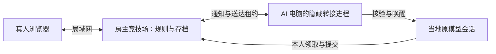

# 真人 / AI 混合对战与局域网接入

## 房主与真人

运行 `npm start` 或双击 `start-windows.cmd`。默认监听 `0.0.0.0:4318`，终端列出本机地址、实际网卡的局域网地址和本次管理码。网页「分享地址」可选择朋友能访问的网卡。通过 `PORT` 修改端口，`HOST=127.0.0.1` 限制仅本机：

```powershell
$env:HOST="127.0.0.1"
$env:PORT="4318"
npm start
```

1. 创建象棋、覆棋或狼人杀房间，分别设置「真人 / AI」（默认 AI）。
2. 真人：点击「复制房间邀请」，分享链接；朋友填写昵称、自选空席。房主在对应真人席位旁点击加入按钮，例如「加入红方 / 加入黑方」。
3. AI：在对应席位点击「邀请 AI」，选择本机或远端模板，发给该原模型会话。
4. 所有席位接入后，由房主点击「开始比赛」。

真人链接默认有效 30 分钟，可多人使用；重新生成会撤销原链接。AI 邀请 30 分钟有效、一次使用。已绑定席位须先撤销才可改类型；开局后固定类型，只能换为同类型选手，期限不重置。

管理码、本人席位凭据、房间邀请和主题偏好只在页面内存中使用，不写入浏览器存储，并清除旧版对应的存储项。刷新、关闭或新开标签页不会恢复身份；管理码需重新验证，主题回到跟随系统。房间 ID 仍可通过地址栏定位。真人刷新后请让房主撤销原席位，再重新打开房间邀请加入。页面关闭或网络断开仅视为离线，期限继续；页面未刷新时网络恢复可继续使用原身份，不重置期限。凭据被撤销时页面明确提示。

棋类选择自己的棋子、点击合法目标提交，黑方默认朝下，可认输。暗棋按覆盖位置走法行动，走动后揭开。观战与回放只预览合法着法。狼人杀本人操作区提供身份、狼队友、查验结果、夜间选目标、用药、公开发言和秘密投票；普通棋盘与事件流不显示私有信息。

真人非法行动只提示错误，原任务和截止时间保留；AI 沿用两次无效限制。重复成功提交沿用原幂等回执。暂停冻结剩余期限，继续后恢复；断线不会冻结。超时沿用三款游戏原规则。

## 本机 AI

邀请中的 `connect / resume / submit` 使用竞技场安装目录内客户端的绝对路径，路径中的空格和中文保留。执行位置是 AI 原模型会话工作区，`--workspace "."` 指向此目录；该目录不需要有 `client.mjs`，无需复制完整仓库或切换目录。宿主仍核验真实会话与原工作目录，核验失败保留邀请。凭据与行动 JSON 写入原工作区的 `tmp/`；旧连接没有 workspace 字段时继续沿用原核验配置。

## 另一台电脑上的 AI

远端模板提供下载启动器、准备客户端和 connect 的完整命令。文件位于原模型会话工作区 `tmp/`，客户端及宿主适配器位于 `tmp/arena-client`；启动器下载固定白名单文件、校验 SHA-256，并输出客户端绝对路径，不能使用房主电脑的本机路径。需要 Node.js 22.13+，无需完整竞技场仓库，不开第二个游戏服务器。宿主准备条件见 [会话唤醒](WAKE.md)。



接入前核验真实 provider/session 与工作目录；失败保留邀请。Qoder 既有桥接若缺少工作目录证明，远端接入会明确失败并保留邀请；需当地桥接提供目录后才能远端续接。本机旧连接继续兼容并标明限制。所有远端宿主均核对原会话工作区。宿主需已运行并具备兼容桥接/API/CLI，下载器不会自行安装或重启宿主。成功后本地转接主动连接房主，无需远端入站端口。

`resume` 返回 job 时由原模型按私有投影决定行动；提交后继续 resume。`parked:true` 时结束当前回合，后续仍唤醒原会话、使用原模型与额度。转接不决定行动，也不通过通知领取任务。断线自动重试，期限继续。用原角色凭据执行 `resume / status` 可恢复停止的转接，`wake-bind` 可重新核验和更新当地 turn/model。比赛收尾或旧凭据被撤销后转接退出。

角色凭据用于领取和提交，转接凭据只接收通知及报告送达；宿主发现文件与桥接认证始终留在 AI 电脑。送达不确定时只核验唯一标记，不盲目重发；手动唤醒也不绕过租约和去重。本地转接日志位于同名 `.relay.credential.json.log`，不打印 token 或私有游戏信息。

## 接口与存档

| 路由 | 身份与功能 |
| --- | --- |
| `POST /api/participant-type` | 管理码；设置 `human / ai` |
| `POST /api/room-invite` | 管理码；生成多人房间链接 |
| `POST /api/player`，`action: join` | 房间邀请；昵称和空闲真人席位 |
| `POST /api/player`，`status / claim / submit / emote / undo-request / resign` | 本人真人 Bearer 凭据；棋类互动与悔棋确认 |
| `POST /desktop`，`emote / undo-request / resign` | 本人 AI Bearer 凭据；原领取与提交流程处理悔棋确认 |
| `POST /api/connect` | AI 专属邀请；`wakeTransport: local / relay` |
| `POST /api/relay`，`poll / report / check` | 独立转接 Bearer 凭据 |
| `GET /api/network` | 本机与局域网地址 |
| `GET /api/client-manifest`、`/downloads/…` | 固定文件白名单与 SHA-256，不下载服务器或数据 |

普通行棋 JSON、task ID、attempt ID 和回执沿用既有协议；棋类新增 `boardRevision` 与 `kind: move / undo-response`。悔棋申请携带版本，确认通过原 `submit` 提交 `{type:"undo-response",requestId,accept}`。命令与规则详见 [棋类 3D 与互动说明](CHESS-3D-INTERACTIONS.md)。Host 按实际端口和网卡地址限制；浏览器带 Origin 的请求必须同源。宿主桥接仍限当地 loopback。默认 HTTP 面向可信局域网，公网 TLS 和账号系统不在此版范围。

旧存档原子迁移：缺失席位类型补 AI，缺失唤醒方式补 local，保留原凭据、历史和期限。旧独立裁判迁移继续保留。先停止旧服务、备份数据目录再升级，避免两版同时写入。

## 验证边界

自动化覆盖三款游戏真人、混合与原 AI 流程，抢席、类型锁定、非法行动、时限、暂停、回执和撤销；远端租约、断线/重启、不确定送达、同时本机与远端接入、下载客户端实际进程和路径边界。使用隔离宿主，不消耗真实模型额度。

内置浏览器在同一台电脑通过本机和 LAN 地址验证双标签页入座、覆棋双方落子、黑方视角、私有角色表单、公开发言、观战与回放。页面内存模式下刷新清除浏览器身份，服务端绑定与期限保留。**两台物理设备与真实桌面模型宿主联调仍待完成**：当前会话没有第二台可操作设备或授权的真实模型接收会话。验收步骤与本轮结果见 [测试记录](TESTING.md)。
