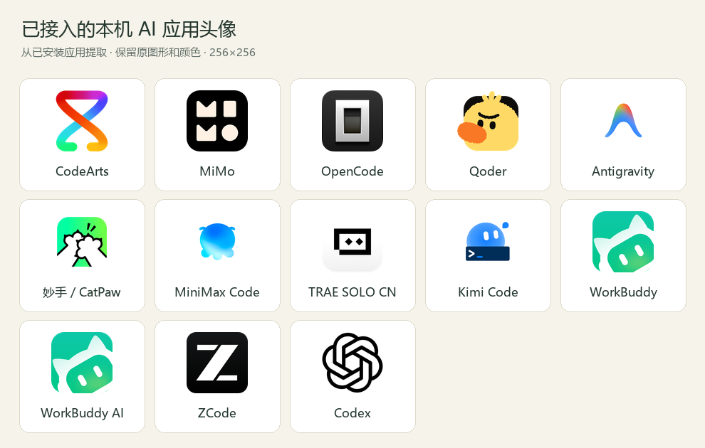

# 日夜主题、棋子辨识、平台头像与手动唤醒

本次改动基于已包含真实宿主 wake 的 main `535f1fcba6859d1c0d3aed2e07e566207ff8666b`，不使用旧版 wait-only 快照覆盖。游戏规则、隐藏角色投影、外部会话验证及五种宿主适配器均保留。

## 外观

右上角提供「跟随系统 / 日间 / 夜间」。每次打开或刷新都跟随系统 `prefers-color-scheme`；手动选择仅在当前页面内存有效，不写入浏览器存储或服务器，不同步其他标签页。新版加载时删除旧版 `arena-theme-preference`。浏览器禁用存储时仍可切换本次页面主题。主题脚本先于样式表执行，减少错误主题闪屏。管理码、真人席位身份和房间邀请也仅留在页面内存。

棋盘采用日间暖木、夜间深松配色。红子为奶油面、朱红字、双线圆框；黑子为墨色实面、亮字、单实框。棋子下方不再显示「红／黑」小字。辨识不只依赖颜色。两套主题的棋子文字对比度均至少 7:1，选中/合法点/吃子提示与棋盘对比度至少 3:1（自动数值测试）。棋子可通过键盘聚焦，选中为双框，合法落点为 ●，可吃子为虚框 ×，上一步为虚线框。

选择棋子仅预览服务端公开视图中已有的合法着法，不提交棋步、不代替模型行动。切换房间、回放位置或新走一步会清除旧选择。

## 平台头像

所有图像来自项目本地 `/assets/avatars/`，不加载任意用户 URL、远端头像服务或带 token 的来源。选手连接与狼人杀座位使用同一白名单。未知平台/图像加载失败会显示默认或文字头像，保留可读 alt。

- 按用户要求从本机已安装应用提取真实图标，保存为 256×256 PNG：Codex、MiMo、CodeArts、Qoder、OpenCode，以及检测到的 Antigravity、妙手/CatPaw、MiniMax Code、TRAE SOLO CN、Kimi Code、WorkBuddy、WorkBuddy AI、ZCode。图标用于 AI 选手连接与狼人杀座位的头像，新增头像不改变宿主唤醒支持范围。
- `scripts/import-local-avatars.ps1` 只读桌面/开始菜单快捷方式和应用图标资源；Codex 使用已安装 Windows 应用包内的 PNG。所有输出均在项目内，每张图小于 1 MB。无须在线下载，也不修改应用安装目录。
- 本机未找到 Cursor、VS Code 的图标，继续保留现有矢量头像。原 Qoder、OpenCode SVG 的许可证/NOTICE 仍随项目保留。
- 每个当前头像的来源文件名、资源索引、提取日期和 SHA-256 见 `public/assets/avatars/manifest.json`；本机图标不标为项目原创或 MIT 授权资产，其权利归相应应用发布者。
- 图标仅用于标识接入平台，不表示合作、授权背书或商标权转让

本机图标预览：

## 覆棋盲棋（2026-10-07 新增）

新增第三种对局 `blind`（覆棋/暗棋）：将帅明置，其余 30 子红黑混洗面朝下；暗棋按所站位置棋种走第一步后揭开，异色揭开移交对方；吃暗子公开身份；吃将制，不强制应将。暗棋真实身份只存在服务端规则引擎，公开视图、事件流与历史回放只包含已揭开信息。界面上面朝下的棋子以描金暗纹圆子加「暗」字呈现，右下角小字显示其覆盖棋种（即当前走法）；被吃棋子按真实身份陈列在棋盘下方的双方缴获区。

界面整体同步重构为「金墨棋院」风格：描金笺纹背景、金色发际线、楷体标题、木纹棋盘与立体圆子（奶油面朱红字 / 墨面米字、内刻环、浮雕字影），日夜双主题令牌与对比度约束保持不变。

## 手动唤醒

已登录管理入口时，对服务端确认为 `mode:wake` 且 `verified:true` 的连接显示唤醒控件。是否能点由服务端当前绑定和任务判断，不根据图标或 provider 名字猜测。未开始、没有待领取任务、未待命、已领取或已送达会禁用并给出原因。

按钮使用既有 `/api/wake-check` 管理路由，并携带管理员诊断中当前的 `bindingId` 与 `attemptId`。服务端对照当前绑定及当前任务，旧界面在换绑或换任务后不能误唤醒新身份。重复点击共享同一 in-flight 任务；已送达不会重发；不确定送达仅核验，不盲目再发。按钮区分核验/投递中、已送达待领取、已领取、核验不确定。请求受理不是模型已经响应。

管理页面只能选择现有 match/seat/绑定快照，不接受任意命令、文件路径、会话 ID 或第三方 token。选手令牌不能调用管理唤醒接口。

## 验证边界

自动测试涵盖主题初始选择/页面内切换/刷新回到系统/禁用存储/旧数据清理、棋子结构与对比度、头像安全白名单和许可证元数据、唤醒身份快照、重复点击、送达不确定不重发，以及最新规则/私密视图/宿主适配器回归。HTTP 和宿主测试全部使用模拟适配器，不实际唤醒外部 LLM。

受现有浏览器访问限制，未完成真实浏览器视觉验收、截图与 Windows 实机验收；自动结构/数值测试不能替代实机视觉验收。

## 取消独立裁判

新局仅需要象棋双方或六位狼人杀选手。独立 judge 邀请、凭据、唤醒和行动任务不再受理。旧历史裁决保留，未决裁判任务迁为管理待办。管理入口可暂停/继续（冻结剩余行动时间）、重试仍有效的行动任务或结束比赛；不能指定赢家或构造棋步。旧数据迁移不删除历史、角色状态或记录。

本轮在 Node 24.19.0 下完整执行 `npm test`，通过 76 项（包含 11 项无裁判专项回归）；没有启动真实宿主模型。此处的测试数是本轮提交前结果，后续以实际运行输出为准。
