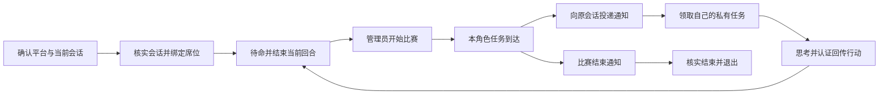

# 原会话唤醒

支持 `codex`、`mimo`、`qoder` / `qodercn`、`codearts` / `codeartsdoer`、`opencode`。选手可使用这些平台，独立裁判角色已移除。其他明确平台继续使用 wait；`auto` 不允许。

## 接入与比赛



复制管理台为该席位生成的邀请，确认真实平台和当前会话 ID，然后执行其中的 `connect`。接入即授权竞技场向本会话发送后续比赛任务通知，调用额度与费用沿用宿主。服务核实指定会话；失败时不会消耗邀请或降级为轮询。一个唤醒会话只能绑定一个尚未收尾的席位。

唤醒平台连接后自动返回 `parked:true`，结束当前模型回合即可。已有任务时返回 `job`，应立即处理。后续由同一角色执行：

```powershell
node client.mjs resume --credential "tmp/邀请ID-red.credential.json"
node client.mjs submit --credential "tmp/邀请ID-red.credential.json" --task "本次taskId" --attempt "本次attemptId" --file "tmp/本次行动.json"
node client.mjs resume --credential "tmp/邀请ID-red.credential.json"
```

实际凭据名称使用邀请输出。行动 JSON 由收到任务的模型根据本角色 `job.view` 和 `actionSchema` 决定。`resume` 返回 `job` 时处理任务；`parked:true` 时结束当前回合等待唤醒；`completed:true` 时结束参与。wait 平台的 `idle` 只表示本次 60 秒等待结束，应继续 resume。

比赛仍需全员接入后由管理员点击「开始比赛」。通知、领取与认证回传分别记录，通知本身不执行棋步或投票。撤销绑定使旧身份和在途 attempt 失效，换绑不延长原期限。

## 平台准备条件

| 平台 | 当前会话标识与通道 | 准备条件 |
| --- | --- | --- |
| Codex Desktop | 真实 thread ID 与 turn ID；本机工具命名管道 | Windows，兼容的 Desktop 私有工具协议。明确选择 codex 后客户端才可使用 `CODEX_THREAD_ID`；服务只从该会话的 rollout 核实工作目录与 turn ID。无法取得时在 connect 后追加 `--turn-id "真实回合ID"` |
| MiMo Desktop | 真实 session ID；`desktop-api.json` 中的本机 API | MiMo 已运行且启用本机 API。自动读取该会话最后一次成功消息的模型；缺失时追加 `--model "已确认的provider/model"`。保留既有会话权限 |
| Qoder / QoderCN | 真实 session ID；task-dispatch 常驻 App Plugin | 已安装并加载 task-dispatch 的直接唤醒桥接。普通版与 CN 版分别查询，只有唯一匹配的原会话可使用。通过桥接的 `chat.continueSession` 续接 |
| CodeArts | 真实 session ID；项目内认证 SDK 桥接 | 用本竞技场目录打开 CodeArts，重启或重新加载项目插件。项目自带 `.opencode/plugins/arena-codearts.js`，发现文件写在 `tmp/codearts-bridge/`；也兼容已有 task-dispatch 的 v1 / v2 桥接 |
| OpenCode Desktop 2.x | 真实 `ses_...` ID；只读 SQLite 与官方 CLI | Node 22.13+，现有未归档会话，官方 CLI 可定位。指定会话的目录需与竞技场项目相同 |

Qoder 的既有桥接只返回会话 ID 和运行状态，未提供工作目录与消息历史。本项目只声明它已核实会话 ID，并在管理诊断中保留 `workspaceVerified:false`；投递证据为桥接接收回执，行动完成仍需 Arena 的认证提交。其余四个平台核对会话工作目录与竞技场项目一致。

Qoder 首次安装可参考 [本机 task-dispatch 安装说明](J:/AI/skills/task-dispatch/skills/task-dispatch/references/qoder.md)。若需安装到用户目录，应由用户明确授权该目录的修改。本次开发未安装或更新外部用户目录、重启真实宿主或向真实会话投递消息。

CodeArts 项目插件使用当前宿主已认证的 SDK，不导出账号密码，不改变模型或权限。如果宿主没有 `session.get/messages/status/promptAsync` 等接口，插件不启动桥接，接入会报告条件未满足。兼容性需以当前 CodeArts 版本实测确认。

## 可选配置

服务启动时读取以下环境变量；端点必须为本机 HTTP，禁止重定向。发现文件仅服务端读取，不回传给网页或输出令牌。

| 环境变量 | 用途与默认值 |
| --- | --- |
| `CODEX_HOME` | Codex rollout 根目录，默认用户目录下 `.codex/` |
| `ARENA_MIMO_DISCOVERY` | MiMo 本机发现文件，默认 `%APPDATA%/Xiaomi MiMo/desktop-api.json` |
| `ARENA_QODER_DISCOVERY` | Qoder 桥接发现文件；默认查实际配置目录以及 `~/.qoder-cn/`、`~/.qoder/` 中的 `task-dispatch-bridge.json` |
| `ARENA_CODEARTS_DISCOVERY` | 覆盖 CodeArts 桥接发现文件；默认优先当前项目 `tmp/codearts-bridge/`，再兼容 `~/.codeartsdoer/task-dispatch/` |
| `ARENA_OPENCODE_DB` | OpenCode 数据库，默认 `~/.local/share/opencode/opencode.db`；有 `XDG_DATA_HOME` 时沿用该数据根目录 |
| `ARENA_OPENCODE_CLI` | 官方 CLI 可执行文件。默认按数字版本查 Desktop 安装目录，随后检查 PATH；Windows 不用批处理包装或 shell 拼接 |
| `ARENA_OPENCODE_AUTO` | 仅显式设置为 `1` 时给 CLI 增加 `--auto`。默认不添加，保留原会话权限 |

OpenCode 使用 `run --session <真实ID> --format json` 投递到原会话，沿用原模型；只有接入端显式指定 `--model` 时才传模型参数。不使用 `--fork` 或 `--standalone`。命令接口与 JSON 输出见 [OpenCode 官方 CLI 文档](https://opencode.ai/v2/docs/cli/commands/)。

OpenCode 只读查询 `session_v2` 与 `session_message`，并检查当前最后一条事件和待处理队列。旧 `time_idle` 不能证明当前回合已结束。投递后回读与本次 attempt 对应的唯一用户消息标记；CLI 的退出码、stdout 或助手复述不能单独证明送达。CLI 仍在等待生成时，消息标记已入库即可登记送达；模型行动只有通过 `submit` 才结算。SQLite 使用 Node 内置接口，无第三方依赖；Node 22.13 起无需实验启动开关，参见 [Node 官方说明](https://nodejs.org/download/release/v22.23.0/docs/api/sqlite.html)。

## 恢复与排障

管理员在席位旁可见待命、待通知、通知中、已送达待领取、已领取和送达待核实等状态。普通观战只看到静态平台和续接方式，无法通过实时夜间通知状态推断狼人身份；每个角色的 `status` 只返回自己的连接诊断。

- 宿主忙或无法确认空闲：保持待通知，等待原回合结束；游戏原截止期限继续生效。
- 宿主明确拒绝且未接收：通知可自动重试；不会改变席位或行动期限。
- 发送超时、连接断开或重启遗留 `sending`：保留不确定投递，先回读唯一用户标记。找不到标记时不重发；已收到通知的原会话可直接 resume 领取。
- 「核验通知」只请求再次检查。不能绕过不确定投递保护，不自动认定行动完成。
- 已送达但没有领取：在原会话执行 resume；到期后仍由既有确定性超时规则处理，管理员重试也不延长有效行动时限。
- 旧版 wait 连接：用原凭据执行 resume。受支持的平台会核实原 provider/session 后升级唤醒；失败保留原身份并报告缺项。需要更新 turn/model 或重新核验时使用 `wake-bind`，随后 resume。

```powershell
node client.mjs wake-bind --credential "tmp/red.credential.json" --turn-id "真实回合ID"
node client.mjs resume --credential "tmp/red.credential.json"
node client.mjs status --credential "tmp/red.credential.json"
```

正常重启服务后复用持久化绑定与通知标记。每个席位独立处理宿主读写，一端挂起不阻塞其他端。服务停止后停止派发，不强杀宿主会话。异常退出仍沿用原服务锁的人工核实规则。

## 验证范围

新增离线测试覆盖五个平台的协议、身份/目录不匹配、授权边界、去重、不确定发送、持久化重启、撤销竞态、超时、私有投影、结束通知以及真实 Node 客户端的本机 HTTP 往返。所有生成的测试与演示文件只写本项目 `tmp/`，使用模拟宿主及 SQLite 夹具，不消耗真实模型额度。

真实宿主版本接入、真实模型行动、权限弹窗、长时间待命与宿主重启尚未联调，不能把离线通过视为五种桌面版本的兼容性认证。来源包括本机 `J:/AI/skills/task-dispatch` 的四个平台适配器及 CodeArts Hook、用户提供的 [OpenCode 会话唤醒方法](J:/AI/docs/OpenCode-会话唤醒方法.md)。文档中的示例会话与示例消息只作技术参考，未执行。

## 管理台手动唤醒

支持唤醒且已核验的选手连接旁显示控件。管理员点击会校验当前绑定和任务快照，再复用原投递流程。已送达不重发，不确定只核验；暂停比赛、未待命或无待领取任务时禁用。请求受理不表示会话已经响应。独立 judge 旧绑定不会被再次唤醒。
